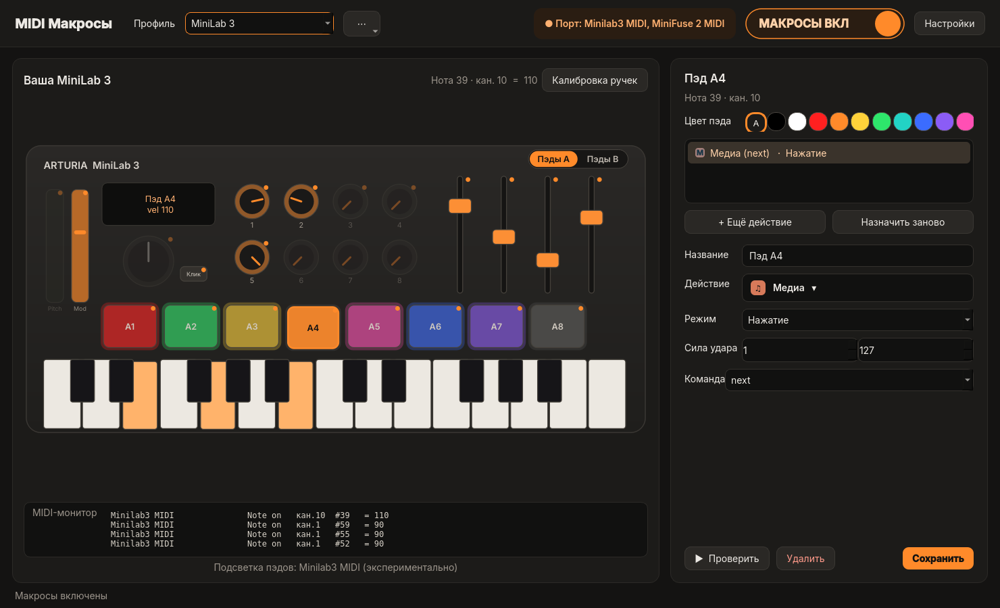
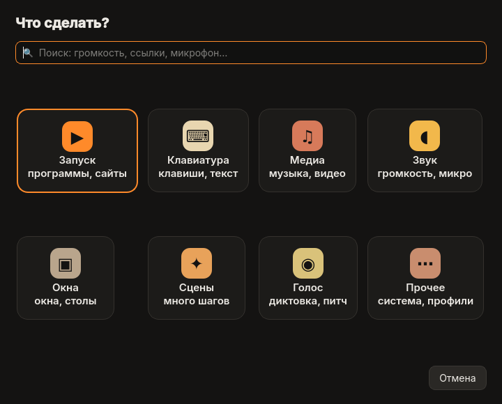
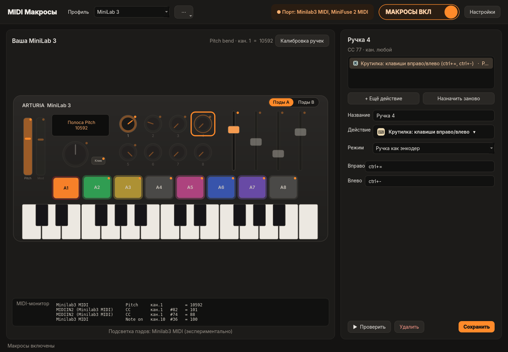
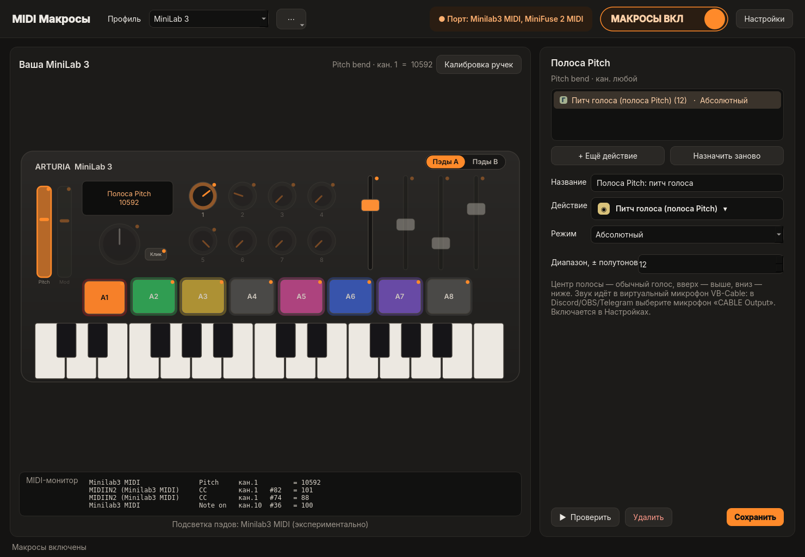
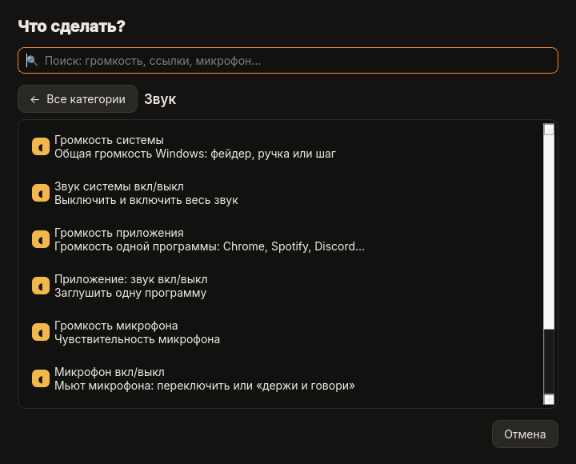
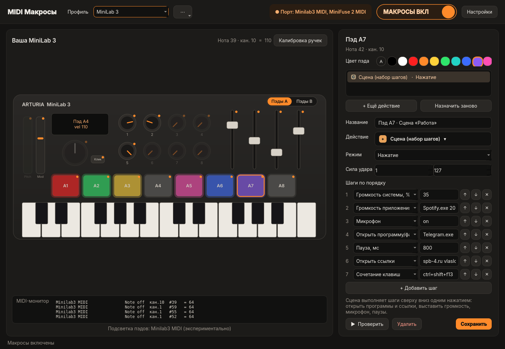
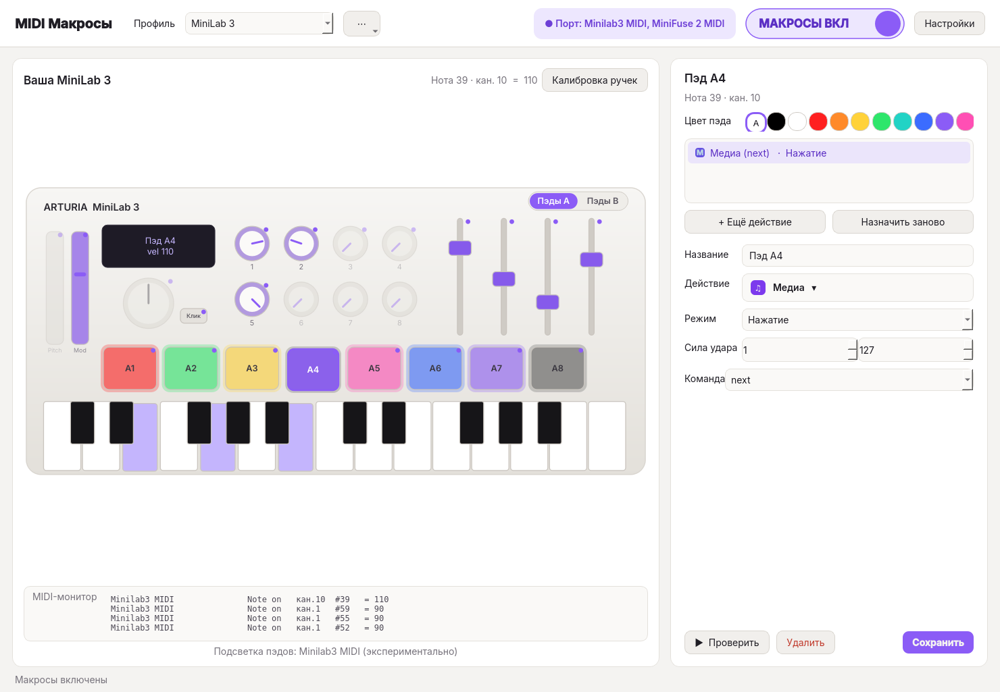

# Arturia MIDI Macros

[](https://github.com/zlatovlasov/arturia-midi-macros/actions/workflows/build-windows.yml)
[](https://github.com/zlatovlasov/arturia-midi-macros/releases/latest)


[](LICENSE)

**Превращает MIDI-клавиатуру Arturia MiniLab 3 в пульт управления Windows.** На любую клавишу, пэд, ручку, фейдер или энкодер можно повесить действие: горячие клавиши, запуск программ, громкость, микрофон, сцены, голосовой ввод и питч голоса. В окне — «цифровой двойник» MiniLab 3, который вживую повторяет каждое касание.



## ⬇️ Скачать

**[Последний релиз → ArturiaMidiMacros.exe](https://github.com/zlatovlasov/arturia-midi-macros/releases/latest)** — один файл, установка не нужна. Windows 11, x64.

> Windows SmartScreen может предупредить о неизвестном издателе (exe не подписан): «Подробнее» → «Выполнить в любом случае».

## Возможности

- 🎛 **Цифровой двойник MiniLab 3** — пэды, ручки, фейдеры и клавиши на схеме повторяют реальные движения; не тронутые ещё контролы полупрозрачные.
- 🧭 **Двухшаговый выбор действия** — 8 плиток-категорий → короткий список с описаниями, плюс поиск.
- ⌨️ **Действия:** сочетания клавиш, макросы с паузами, текст, запуск программ, до 10 ссылок на одно нажатие, медиа, окна и рабочие столы, скриншоты, PowerShell.
- 🔊 **Звук:** громкость системы и отдельных приложений, микрофон (вкл/выкл, push-to-talk), смена устройства вывода.
- 🎬 **Сцены** — цепочка шагов на одно нажатие (громкость, программы, ссылки, микрофон…).
- 🎙 **Голос в текст** — Windows (Win+H) или офлайн через Vosk.
- 🎚 **Питч голоса** на полосе Pitch (±12 полутонов) через виртуальный кабель VB-Cable.
- 🩺 **MIDI-монитор** и мастер **«Калибровка ручек»** из 16 шагов — если ручки шлют нестандартные CC.
- 🌈 Подсветка пэдов (экспериментально), профили-слои, тёмная/светлая тема, трей и автозапуск.

| Выбор действия | Калибровка | MIDI-монитор |
|---|---|---|
|  |  |  |
|  |  |  |

## Установка

1. Скачайте `ArturiaMidiMacros.exe` из [релизов](https://github.com/zlatovlasov/arturia-midi-macros/releases/latest) и положите в постоянную папку, например `C:\Programs\MidiMacros\`.
2. Подключите MiniLab 3 по USB (через хаб звуковой карты, например MiniFuse, тоже работает) и запустите exe.
3. Программа сама найдёт MiniLab 3 и предложит готовый профиль.

**Необязательно — VB-Cable для питча голоса:** установите бесплатный [VB-Cable](https://vb-audio.com/Cable/) (`VBCABLE_Setup_x64.exe` от администратора → Install → перезагрузка). Затем «Настройки» → «Питч голоса на полосе Pitch», а в Discord/OBS/Telegram выберите микрофон **«CABLE Output»**.

## Как пользоваться

1. Тронь контрол на клавиатуре или кликни его на схеме — справа откроются настройки.
2. «+ Ещё действие» → выбери категорию и действие → заполни поля → «Сохранить». «▶ Проверить» запускает действие без клавиатуры.
3. Ручки не реагируют? Открой «Калибровка ручек» и покрути каждый контрол по подсказке.

Полное руководство: **[docs/GUIDE.md](docs/GUIDE.md)**.

## Сборка из исходников

Требуется **Python 3.12** (для 3.13+ у `python-rtmidi` нет готовых wheel).

```bat
git clone https://github.com/zlatovlasov/arturia-midi-macros.git
cd arturia-midi-macros
build.bat
```

Готовый файл: `dist\ArturiaMidiMacros.exe`. Тесты: `pip install -r requirements.txt pytest && python -m pytest -q tests`.

**CI:** каждый пуш собирает exe на `windows-latest` (GitHub Actions, артефакт `ArturiaMidiMacros`). Тег `vX.Y.Z` автоматически прикрепляет exe к релизу.

## Структура

```
app/
  main.py        точка входа, трей, автозапуск
  gui.py         главное окно и цифровой двойник MiniLab 3
  picker.py      двухшаговый выбор действия
  calib.py       мастер калибровки ручек
  actions.py     каталог действий и их выполнение (WinBackend)
  engine.py      сопоставление MIDI-событий с назначениями
  midi_io.py     MIDI-входы/выходы (mido + python-rtmidi)
  device.py      определение MiniLab 3 / Arturia
  leds.py        подсветка пэдов (SysEx)
  voice.py       голос в текст (Windows / Vosk)
  voice_fx.py    питч голоса → VB-Cable
  presets.py     готовые профили
  config.py, theme.py, macro.py, controller.py
tests/           pytest (37 тестов)
docs/            руководство и скриншоты
build.bat        локальная сборка PyInstaller
```

Стек: Python 3.12, PySide6, mido / python-rtmidi, pycaw, sounddevice, numpy, Vosk, PyInstaller.

## Планы

- Профили под приложения с автопереключением по активному окну
- Управление OBS через WebSocket (сцены, запись, источники)
- Photoshop и Lightroom (через скрипты / MIDI2LR), видеоредакторы, редакторы кода
- Мягкие звуки-подтверждения на команды (например, на выключение микрофона)

## English

**Arturia MIDI Macros** turns an Arturia MiniLab 3 into a Windows 11 control surface: map any key, pad, knob, fader or encoder to hotkeys, app launches, volume and mic control, multi-step scenes, speech-to-text and a live voice pitch effect (±12 semitones via VB-Cable). Includes a live "digital twin" of the controller, a MIDI monitor and a 16-step knob calibration wizard. **[Download the latest .exe](https://github.com/zlatovlasov/arturia-midi-macros/releases/latest)** · build from source with Python 3.12 and `build.bat` · MIT licensed.

---

Сделано в студии **[SPB-4](https://spb-4.ru)** · Telegram [@vlaslesha](https://t.me/vlaslesha)
